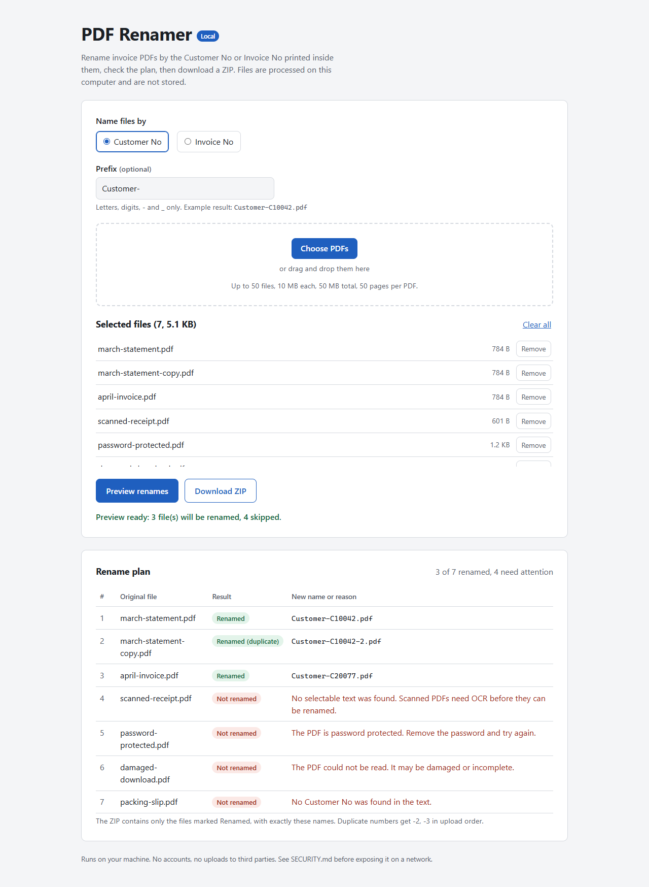

# PDF Renamer Local

A small local web app for a dull but real office chore: a folder of invoice PDFs named `scan_0042.pdf`, `document(3).pdf` and so on. It reads the Customer No (or Invoice No) printed inside each PDF, shows you the planned new names, and gives you a ZIP with exactly those names.



## What it does

- Accepts a batch of PDFs by file picker or drag and drop.
- Extracts `Customer No`, `Customer Number`, `Customer #` or `Customer ID` (or the Invoice equivalents) from the text layer.
- Shows a preview: new name for each file, or a plain reason why it was skipped (scanned, password protected, damaged, not a PDF, no number found, too large, too many pages, too slow).
- Downloads a ZIP whose entries are byte-identical to the uploads and named exactly as previewed.

It runs on `127.0.0.1` only. Nothing is sent to any outside service and nothing is written to disk.

## Run it

Python 3.11 or newer.

```bash
python -m venv .venv
# Windows: .venv\Scripts\activate    macOS/Linux: source .venv/bin/activate
pip install -r requirements.txt
python -m pdf_renamer_local            # http://127.0.0.1:8000
python -m pdf_renamer_local --port 9000
```

Want something to try it on? `python scripts/make_sample_pdfs.py samples` writes a few synthetic invoices plus a scanned, a locked and a damaged file.

## Test

```bash
pip install -r requirements-dev.txt
python -m pytest
```

Every test PDF is generated in code (`tests/pdf_factory.py`), so no real documents are in the repo. The suite covers extraction patterns, naming rules and collisions, mixed batches, preview and ZIP equivalence, size, count, page and time limits, a hung or crashing parser, Host, Origin and CSRF checks, and hostile filenames.

Screenshots and a real-browser download check:

```bash
pip install -r requirements-screenshot.txt
python scripts/screenshot.py --channel msedge    # or chrome, or run `playwright install chromium` and omit --channel
```

This writes `docs/screenshot-desktop.png` and `docs/screenshot-mobile.png`, then clicks Download ZIP and fails if the archive names differ from the preview table.

## Naming rules

- New name is `<prefix><value>.pdf`. The prefix is optional, starts with a letter, digit or `_`, and allows up to 32 characters of `A-Z a-z 0-9 - _`. Invalid prefixes receive an error before parsing.
- The extracted value must start with a letter or digit, contain at least one digit, and use only letters, digits and `-`. Labels like `Customer Name: Bob` are ignored.
- The complete identifier token must be valid. One trailing period, comma or semicolon is accepted before whitespace, the end of the text or another recognized label. Internal punctuation, overlong values and values cut off by the text limit are rejected rather than shortened into a different number.
- A digit-containing token immediately after an identifier on the same extracted line, including after one allowed trailing period, comma or semicolon, is ambiguous and is skipped, with a review reason if no later valid label is found. PDF kerning can split one visible identifier this way. Tokens are never joined or guessed. This also rejects an unlabelled trailing date such as `Invoice No: INV-1, 2026-01-15`; use an explicit field label such as `Date:`. Ordinary prose and the next recognized identifier label remain accepted.
- Windows reserved names (`CON`, `NUL`, `COM1`, `LPT1` and the rest) get a leading `_`.
- Duplicates get `-2`, `-3`, ... in upload order. The comparison ignores case so the ZIP extracts cleanly on Windows and macOS, and a suffix never lands on a name another file already has.
- The uploaded filename is only shown in the table, after stripping folders and control characters. It is never used to build a path or a ZIP entry.

## Design and tradeoffs

**Stateless preview, verified download.** The server keeps nothing between requests. Preview returns a `plan_id`, a SHA-256 over the mode, prefix, each file's hash and size, and each assigned name. Download sends the same files again with that id; the server validates the id format before parsing, rebuilds the plan and returns `409` if anything changed. Missing or malformed ids receive `422` without launching the PDF parser. This costs a second upload of the files, which is cheap on loopback, and in exchange there is no server-side cache to leak or clean up.

**Parser in a separate process.** PDF parsing runs in a child Python process (`python -I`) that receives bytes over a pipe and replies with bounded JSON. The child receives a small environment allowlist, without inherited provider credentials. Each file's deadline includes pipe writes, flushing, and waiting for a reply. The whole request has a budget. A hung or crashed parser is killed, that file is marked, and a fresh process picks up the rest. On Linux and macOS the child also gets an address space limit. This is process isolation, not an operating-system sandbox: a compromised parser still has the current user's filesystem and network permissions.

**Streaming upload limits.** Processing admission happens before reading an upload; saturated requests receive `503` without retaining their bodies. Admission remains held through ZIP creation and response delivery. The multipart body is parsed in memory with a read deadline and limits for bytes, parts, fields, boundaries, and headers. Truncated bodies and ambiguous framing are rejected. An oversized single file is dropped and reported in the table instead of failing the whole batch.

**No OCR.** Scanned PDFs are reported as needing OCR. OCR remains a separate step to keep the runtime small and predictable.

**pypdf** (BSD-3-Clause) reads PDFs, with **cryptography** (Apache-2.0 or BSD-3-Clause) for AES support. Files with an empty open password can be read without changing the exported bytes.

Limits are configurable with environment variables:

| Variable | Default |
| --- | --- |
| `PDFR_MAX_FILES` | 50 |
| `PDFR_MAX_FILE_MB` | 10 |
| `PDFR_MAX_TOTAL_MB` | 50 |
| `PDFR_MAX_PAGES` | 50 |
| `PDFR_FILE_TIMEOUT` (seconds) | 10 |
| `PDFR_REQUEST_TIMEOUT` (seconds) | 60 |
| `PDFR_UPLOAD_TIMEOUT` (seconds) | 15 |
| `PDFR_MAX_TEXT_CHARS` | 200000 |
| `PDFR_MAX_PARALLEL_JOBS` | 2 |
| `PDFR_WORKER_MEMORY_MB` (POSIX only) | 768 |
| `PDFR_ALLOWED_HOSTS` | `127.0.0.1,localhost,::1` |
| `PDFR_PUBLIC_SCHEME` | unset; use `https` behind a TLS-terminating proxy |

Settings reject zero, negative, nonfinite, and excessive limits. The defaults suit a single local user. Raising limits increases memory use; parser memory caps are supported on POSIX only.
The CLI also allows the exact loopback address selected with `--host` by default. An explicit `PDFR_ALLOWED_HOSTS` replaces that default allowlist.

## Limitations

- Text-layer PDFs only. Scanned images are rejected with a clear message.
- Password-protected PDFs are not unlocked. PDFs with an owner password but no open password are read normally.
- The label and identifier must share one extracted text line, with horizontal spaces including nonbreaking spaces accepted. Empty or unsupported occurrences are skipped; values on later lines or pages are not guessed.
- The per-process memory cap is not applied on Windows; the size, page and time limits still are.
- There is no authentication. See [SECURITY.md](SECURITY.md) before running it anywhere but your own machine.
- Renaming does not sanitize a PDF. Metadata, embedded content, and the original document bytes remain unchanged. Review documents separately before sharing them.

## Layout

```
pdf_renamer_local/
  app.py        routes, Host/Origin/CSRF checks, security headers
  uploads.py    streaming multipart parser with limits
  runner.py     parser process management and timeouts
  worker.py     child process entry point
  extract.py    pypdf text extraction and number matching
  naming.py     filename allowlist, reserved names, duplicates
  plan.py       preview plan, plan id, ZIP
  index.html, static/   UI (no framework, no inline script)
tests/          pytest suite and synthetic PDF factory
scripts/        sample PDFs and screenshots
```
